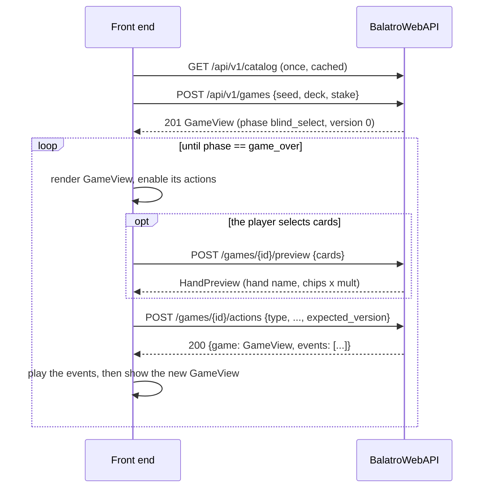

# BalatroWebAPI documentation

BalatroWebAPI is an HTTP API for playing Balatro runs from a front end. The
game rules are not reimplemented here. They come from
[BalatroEngine](https://github.com/ArnoStar/BalatroEngine), which reproduces
Balatro 1.0.1o exactly: the same seed and the same choices give the same run
as the original game.

| Document | Read it to |
|---|---|
| [Getting started](getting-started.md) | run the server and play a hand with `curl` |
| [Endpoints](endpoints.md) | look up every endpoint: request, response, status codes, examples |
| [Data models](models.md) | look up every JSON object, field by field |
| [Front-end flows](flows.md) | build the game screens: what to call and when, from the main menu to game over |
| [Animations](animations.md) | replay what happens during an action (the `events` timeline) |
| [Rendering](rendering.md) | draw cards with the game's sprite sheets, show names and descriptions |
| [Architecture](architecture.md) | understand or change the server (layers, storage, replay, concurrency) |

Contributors should also read [`AGENTS.md`](../AGENTS.md), the project's
rules.

## The model in one page

- **A run** (also called a *game*) is created from a seed, a deck, a stake
  and optionally a challenge. It has an `id`.
- **A run waits for one decision at a time.** Its `phase` says which screen it
  is on: `blind_select`, `playing`, `round_eval`, `shop`, `pack` or
  `game_over`.
- **`GET /games/{id}` returns a `GameView`**: everything the player can see
  (hand, jokers, shop, score, money...) and `actions`, the list of actions
  the game allows right now.
- **`POST /games/{id}/actions` applies one action.** The server plays it, runs
  the game until it waits for the player again, and returns the new
  `GameView` with `events`, what the player saw happen, timed for animation.
- **Cards are referred to by `id`.** A card keeps its id for the whole run.
- **Every accepted action increments `version`.** Send `expected_version` so
  that a stale action (a double click, a second tab) is refused rather than
  applied to a state the player didn't see.
- **A refused action changes nothing.** The response is `409 illegal_action`
  with a message, and the run stays exactly as it was.

