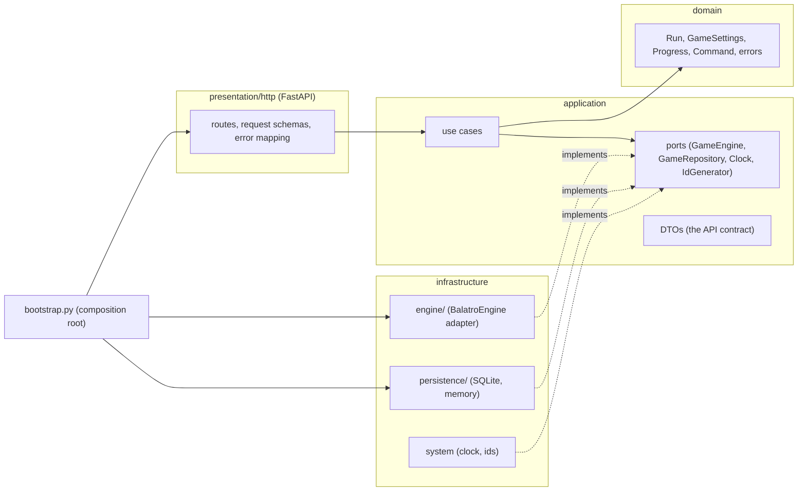
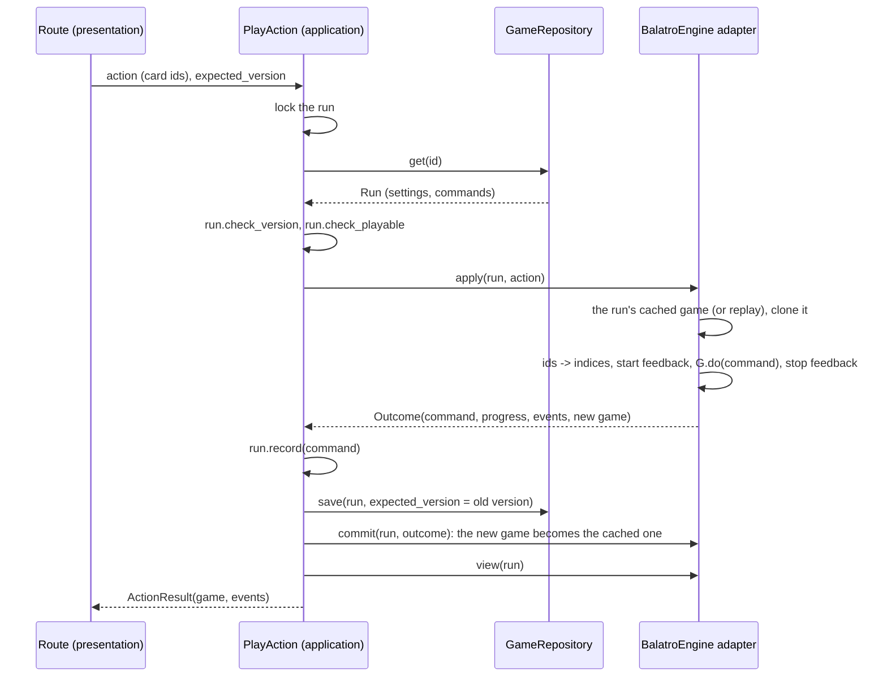

# Architecture

How the server is built, and why. The rules for changing it are in
[`AGENTS.md`](../AGENTS.md).

## The central idea: a run is its history

BalatroEngine is deterministic: a run started with the same settings and
given the same commands always ends in the same state, down to the last
random draw. So the server stores a run as:

- its **settings** (seed, deck, stake, challenge, game speed), and
- the ordered list of **commands** the player made, in the engine's format.

Everything else (cards, shop, score, money) is derived by replaying the
commands. The **version** of a run is the number of its commands. This has
useful consequences:

- **Storage is small**: two tables, one row per run and one per command.
- **Restarts lose nothing**: a run that is not in memory is rebuilt by replay.
- **History is exact**: `GET /games/{id}/history` is a complete,
  reproducible record, which can even be checked against the original game.
- **No state can drift.** There is no second copy of the game state to keep
  consistent.

## Layers

The code follows a clean architecture. Dependencies point inwards only, and
`tests/test_architecture.py` enforces it.



| Layer | Package | Holds | May import |
|---|---|---|---|
| Domain | `balatro_api.domain` | `Run` (settings, commands, progress, version rules), `GameSettings` (validation), `Phase`, `Progress`, `Command`, errors with stable codes | nothing else |
| Application | `balatro_api.application` | one class per use case (`use_cases.py`), the DTOs returned and accepted (`dto.py`), the ports (`ports.py`), per-run locks | domain |
| Infrastructure | `balatro_api.infrastructure` | `engine/`: the only code that imports `balatro`. `persistence/`: SQLite and in-memory repositories. `system.py`: clock and ids | domain, application, the engine |
| Presentation | `balatro_api.presentation.http` | FastAPI routes, pydantic request schemas, mapping errors to problem details | domain, application, FastAPI |
| Composition | `bootstrap.py`, `main.py`, `config.py` | picks the adapters, builds `UseCases`, creates the app from environment settings | everything |

### Domain

`Run` is the aggregate. Its rules are those every run obeys, independent of
Balatro's rules:

- `version` is `len(commands)`.
- `check_version(expected)` raises `VersionConflict` if a client acted on
  another version.
- `check_playable()` raises `GameOver` once the run is over.
- `record(command, progress, at)` appends one accepted command.

`GameSettings` validates the shape of the settings: seed of 1 to 8
alphanumerics, stake 1-8, game speed 0.5, 1, 2 or 4. Whether a deck or
challenge exists is the engine's knowledge, checked through the port.

### Application

| Use case | Does |
|---|---|
| `CreateGame` | normalizes the settings through the engine, starts the game, stores the run |
| `GetGame`, `GetLegalActions`, `PreviewHand` | read-only views of a run |
| `ListGames`, `GetHistory`, `GetCatalog` | listings and static data |
| `PlayAction`, `RunDebugCommand` | change a run (see below) |
| `DeleteGame` | deletes the run and drops its cached game |

Ports:

- **`GameEngine`**: the game rules: check settings, start, view, list legal
  actions, apply an action (returning an `Outcome`), commit, preview, catalog.
- **`GameRepository`**: `add`, `get`, `save(run, expected_version)`
  (optimistic), `delete`, `list`.
- **`Clock`** and **`IdGenerator`**.

The DTOs in `dto.py` are plain frozen dataclasses. FastAPI serializes them
directly and builds the OpenAPI schema from them, so they *are* the API
contract.

### Infrastructure: the engine adapter

`infrastructure/engine/` translates between the application and BalatroEngine:

| Module | Role |
|---|---|
| `adapter.py` | `BalatroEngine`, the `GameEngine` port: the game cache, replay, applying actions on copies, settings checks |
| `commands.py` | `PlayerAction` (cards by id) → engine command (cards by index), and the engine's legal actions → `LegalAction`s with card ids |
| `presenter.py` | the engine's `Game` → `GameView` (only what the player can see), engine feedback → events |
| `catalog.py` | the engine's static data and sprite positions → `Catalog` |

### Infrastructure: persistence

`SqliteGameRepository` keeps two tables:

```sql
runs     (id, seed, deck, stake, challenge, game_speed, engine_version, version,
          phase, ante, round, dollars, won, created_at, updated_at)
commands (run_id, seq, command)        -- command: JSON in the engine's format
```

`save(run, expected_version)` runs in one transaction. It updates the run row
only `WHERE version = expected_version`, then inserts the new commands. If
another process saved first, no row matches and `VersionConflict` is raised.
`phase`, `ante`, `round`, `dollars` and `won` are a cache for `GET /games`;
the commands are the truth. `InMemoryGameRepository` has the same behaviour,
without the file.

## The life of an action



Every step before `commit` can fail without consequence:

- **The engine refuses the action** (`IllegalAction`): the copy is thrown
  away and the run's game is untouched.
- **The engine crashes** (a bug): same.
- **The save fails** (`VersionConflict`, another process acted first): the
  command isn't stored and the copy isn't kept.

Playing on a copy (`Game.clone()`, about 6 ms) is what makes refused actions
side-effect free. Some engine checks only happen after the cards are selected,
and selecting cards runs game frames.

## The game cache

The adapter keeps live engine games in an LRU cache (`BALATRO_API_CACHE_SIZE`,
256 by default), each tagged with the run version it is at:

- **A hit** (same version) is used directly.
- **A miss or another version** (the server restarted, or another process
  played the run) rebuilds the game by replaying the run's commands, a few
  milliseconds per command.
- A reader that replays an older version never overwrites a newer cached game.

## Concurrency

- **Per run, one change at a time.** The application holds a per-run lock
  for each change (`RunLocks`).
- **A cached game is used by one thread at a time.** The adapter holds its
  own per-run lock around every use, reads included: the engine's
  `legal_actions` and `preview_hand` swap state temporarily.
- **Across processes** (several workers sharing one SQLite file), the
  optimistic `save` guarantees that only one action is accepted per version.
  The version tag on cached games guarantees that a process never uses a
  stale game.

## Timing

BalatroEngine runs the game frame by frame, exactly like the original. A few
effects land after animations, and their timing decides some interactions:
whether a joker cut by Ceremonial Dagger is gone before the hand is drawn,
for example. The server always runs an action until the game waits for the
player again, at 60 frames per second and at the run's `game_speed`. That is
the game's behaviour when a player acts once the screen is idle. `game_speed`
is part of the run's settings for this reason. The `t` of each event comes
from the same clock.

## Hidden information

The presenter only exposes what the player can see:

- no deck order, no RNG state, no upcoming shop or pack contents;
- face-down cards with nothing but their id;
- the deck's remaining cards sorted and without ids.

Card ids are stable for the whole run, which the front end needs to follow
cards. Ids in the deck view would let a client recognize a card later drawn
face down, which is why the deck view leaves them out.

## Versions

- **The API** is versioned in its path (`/api/v1`). Changes within v1 are
  additive.
- **The engine** is pinned to a git tag in `pyproject.toml`. Each run stores
  the `engine_version` it was created with. An engine release that changes
  game logic could make old runs replay differently; such a release must say
  so.
