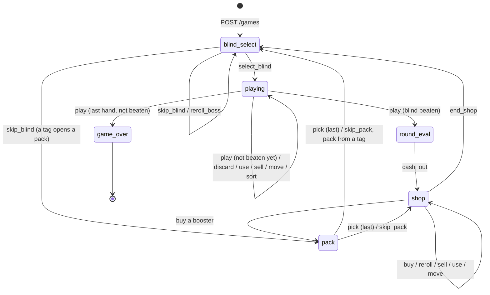

# Front-end flows

How a front end drives a run, screen by screen. Every screen works the same
way:

(With sign-in on, every request carries the player's access token; on
`401 unauthenticated`, refresh it at the identity service and send the request
again. See [endpoints.md, Authentication](endpoints.md#authentication).)

1. Render the `GameView`.
2. Enable what its `actions` list.
3. Send one action, with `expected_version`.
4. Play the returned `events`, then render the returned `game`.



## Start or continue a run

- **New run.** `POST /games` with `seed` (or none for a random one), `deck`,
  `stake`, or a `challenge`. Decks, stakes and challenges come from
  `GET /catalog`.
- **Continue.** `GET /games` lists runs, most recent first, with their phase,
  ante and money. Open one with `GET /games/{id}`.
- **Delete.** `DELETE /games/{id}`.

## Blind select (`phase: blind_select`)

`blind_select.choices` holds the ante's three blinds with their `state`, the
`chips` needed, the `reward`, and the tag skipping gives (`skip_tag`). The one
on deck is `blind_select.on_deck`.

- `select_blind` plays the blind on deck → `playing`.
- `skip_blind` (Small and Big only) takes the tag. Some tags act at once:
  money, or a booster pack that opens → `pack`, after which the run comes
  back here. The next blind is then on deck.
- `reroll_boss` (when listed, $10) draws a new boss.
- `use` or `sell` a consumable, `sell` or `move` a joker: all allowed here
  too, as in the game.

## Playing a blind (`phase: playing`)

The hand is `hand`, left to right. `blind` is the blind, `round_score` the
score so far, `hands_left` and `discards_left` what is left.

1. **Selecting cards.** The player clicks cards; the selection lives in the
   front end. After each change, call `POST /preview` with the selection and
   show `hand`, `level`, `chips` × `mult` as the game does above the hand.
   Show "Not allowed" when `not_allowed` is true, and `????` when `hidden` is
   true. A card with `forced_selection` (Cerulean Bell) is always selected.
2. **Playing or discarding.** Send `play` or `discard` with the card ids (1 to
   5, a forced card included). The `events` show the cards moving to the play
   area, each scoring pop-up, the hand's score, the cards going to the discard
   pile and the new cards drawn. Then:
   - If the blind is beaten → `round_eval`.
   - If hands are left → still `playing`.
   - If no hand is left (and Mr. Bones doesn't save the run) → `game_over`.
3. **Other actions.** `sort` (by `rank` or `suit`; the choice sticks),
   `move` to reorder hand cards or jokers (position matters for many jokers),
   `use` a consumable, `sell` a joker or consumable.

**Consumables with targets.** A Tarot or Spectral card that acts on hand cards
is listed with `min_targets`/`max_targets`. Let the player select that many
hand cards, then send `{"type": "use", "card": id, "targets": [ids]}`. If the
targets don't fit (too many, or a card the consumable can't change), the
answer is `409 illegal_action` and nothing happens. A consumable that needs no
targets (a Planet, The Hermit, ...) is sent without `targets`.

## Cashing out (`phase: round_eval`)

`round_eval.rows` lists the money earned (blind reward, remaining hands,
interest, jokers, tags) and `round_eval.total` the sum. `cash_out` collects it
(a `dollars` event) → `shop`. If the boss of ante 8 was just beaten, `won`
becomes true. The run goes on in endless mode: show a win screen, then let
the player continue or leave.

## The shop (`phase: shop`)

`shop.jokers` are the card slots (jokers, consumables, playing cards),
`shop.vouchers` the ante's voucher, `shop.boosters` two booster packs. Each
card has a `cost`.

- `buy` a card with its `card` id. The `buy` entries in `actions` are those
  the player can afford and has room for. A consumable that can be used right
  away also has a `use: true` entry: "buy and use".
- `buy` a voucher redeems it. `buy` a booster opens it → `pack`.
- `reroll` (its `cost` is in the action) restocks the card slots.
- `sell` or `use` jokers and consumables, `move` to reorder them.
- `end_shop` → `blind_select` for the next blind.

## A booster pack (`phase: pack`)

`pack.cards` are the cards to choose from, `pack.kind` the pack type, and
`pack.choices_left` how many more can be taken. For Tarot and Spectral packs
the hand is dealt, so `hand` holds cards that can be targeted.

- `pick` takes a joker or playing card, or uses a Tarot, Planet or Spectral
  card. Send `targets` when the action lists `min_targets`. When no choice is
  left, the pack closes.
- `skip_pack` closes it at once.

The pack then returns to where it was opened: the shop, or the blind select
screen for a pack from a tag.

## Game over (`phase: game_over`)

`actions` is empty and every action answers `409 game_over`. The `GameView`
still shows the final state, and `GET /games/{id}/history` gives the run's
commands.

## Handling errors and staying in sync

```mermaid
sequenceDiagram
    participant UI as Front end
    participant API
    UI->>API: POST /actions {type: "play", cards, expected_version: 4}
    alt accepted
        API-->>UI: 200 {game (version 5), events}
    else the game refuses it
        API-->>UI: 409 illegal_action {detail}
        Note over UI: show detail; the run is unchanged (still version 4)
    else the run moved on (double click, another tab)
        API-->>UI: 409 version_conflict {current_version: 5}
        UI->>API: GET /games/{id}
        API-->>UI: GameView (version 5)
    end
```

- **Always send `expected_version`.** Then an action is only ever applied to
  the state the player saw.
- **`illegal_action` changes nothing.** Show `detail` and keep the current
  view. Disabling what `actions` doesn't list avoids most of these.
- **Resync when in doubt.** After a network error, a `version_conflict` or a
  page reload, call `GET /games/{id}`. Reads never change a run.
- **Debug helpers** (`POST /games/{id}/debug`, when enabled) are for
  development: jump to an ante, add a joker, force a boss, beat a blind.
